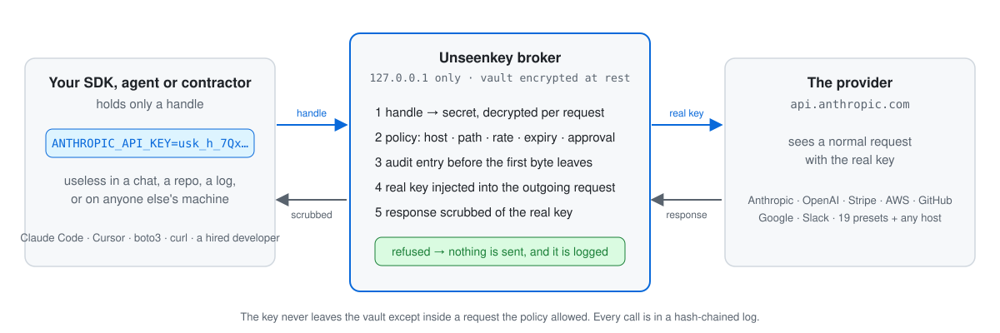

<p align="center">
  
</p>

<h1 align="center">Unseenkey</h1>

<p align="center">
  <b>Let AI agents, scripts and the people you hire use your API keys — without ever seeing them.</b>
</p>

<p align="center">
  <a href="https://github.com/Bhagyesh97/unseenkey/actions/workflows/ci.yml"></a>
  <a href="https://github.com/Bhagyesh97/unseenkey/releases/latest"></a>
  <a href="LICENSE-APACHE"></a>
  
  
</p>

<p align="center">
  <a href="#install">Install</a> ·
  <a href="#two-minutes-with-claude-code">Quickstart</a> ·
  <a href="#how-it-works">How it works</a> ·
  <a href="#what-a-handle-can-do">Features</a> ·
  <a href="#security">Security</a> ·
  <a href="docs/00-README.md">Docs</a>
</p>

---

Every SDK, `.env` file and AI agent asks for the raw key, and once it exists in plaintext it gets pasted into a chat, committed to git, printed in a log, or handed to a contractor you'll never see again. **Unseenkey keeps the key in an encrypted vault on your machine and hands out a handle instead.** The handle looks like a key to whatever receives it, but it only works through the local broker, which swaps it for the real key at the last moment, checks a policy, scrubs the key out of the response, and writes every call to a tamper-evident log.

A leaked handle costs you nothing. A leaked key costs you until you notice.

> **Status: v0.1, alpha.** Works and is tested on Windows, macOS and Linux. Not yet externally audited: use it with keys you can rotate. Delegating keys to other people through a hosted broker is designed, not built.

## How it works

<p align="center">
  <picture>
    <source media="(prefers-color-scheme: dark)" srcset="docs/assets/how-it-works-dark.svg">
    
  </picture>
</p>

## Two minutes with Claude Code

```sh
usk init                          # pick a password; write down the 24 recovery words
usk add anthropic                 # paste the key at a hidden prompt; provider detected, host-locked
usk env anthropic --policy chat   # prints ANTHROPIC_BASE_URL + ANTHROPIC_API_KEY=usk_h_…
claude -p "hello"                 # Claude Code now calls Anthropic through the broker
usk log                           # every call, hash-chained
```

`--shell powershell|cmd|dotenv` prints the variables for your shell or `.env`. The daemon starts itself on first use, listens on loopback only, and locks after 15 minutes without a request or when the screen locks or the machine sleeps.

## What a handle can do

| | |
|---|---|
| **Policy per handle** | Presets for each provider (`stripe:payments` = take payments, no refunds or payouts), explained in plain English. Expiry, request caps, time windows, approvals. |
| **Hard caps** | `--cap 500/day`: the 501st request is refused before it leaves the machine. |
| **Canaries** | `--canary`: a handle that never works. Plant it in `.env.example`; any use means someone has your files, and the vault locks. |
| **Incident responses** | A burst of refused requests throttles, pauses, asks you, or locks the vault — your choice per handle. |
| **Approvals** | Live prompts in the desktop app or `usk approve`: allow once, allow always, deny. |
| **Camouflage** | Handles shaped like the provider's own keys (`sk-proj-usk-…`) for SDKs that validate formats. Every format carries the `usk` marker. |
| **AWS and OAuth2** | boto3, the AWS CLI and the JS SDK sign with a placeholder; the broker re-signs with the real key. OAuth2 refresh tokens stay in the vault; the broker keeps the access token fresh. |
| **MCP server** | `usk mcp install claude-code` (or `claude-desktop`, `cursor`, `windsurf`): the agent gets tools, never values. |
| **Projects** | Group keys by the app that uses them. `usk project protect` (or "Protect a project" in the app) moves a folder's `.env` keys into the vault in one step; AI tools working in that folder see only its keys, and a daily request limit per project stops a runaway bill. |
| **`.env` guard** | `usk guard fix .env` moves real keys into the vault and rewrites the file with handles. |
| **Desktop app** | Projects with a status panel, keys, agent access, approvals, activity with chain verification, one-click MCP setup, Windows Hello, signed auto-updates. |

More of the same:

```sh
usk handle create stripe --policy payments --expires-days 7 --cap 500/day   # for a contractor: gone next week
usk handle create stripe --canary                                            # a tripwire for .env.example
usk add aws-dev && usk env aws-dev                                           # boto3 and the AWS CLI through the broker
usk add google-oauth                                                         # paste a refresh token or gcloud's ADC file
usk run --with DATABASE_URL=prod-db -- ./app                                 # for what cannot be proxied (audited, scrubbed)
```

## Install

```sh
scoop bucket add unseenkey https://github.com/Bhagyesh97/scoop-unseenkey && scoop install usk   # Windows
brew install Bhagyesh97/unseenkey/usk                                                          # macOS, Linux
winget install Unseenkey.Unseenkey                                                             # desktop app, Windows (listing under review)
cargo install --locked --git https://github.com/Bhagyesh97/unseenkey usk                       # from source, Rust 1.85+
```

Archives and installers for every platform are on the [Releases](https://github.com/Bhagyesh97/unseenkey/releases) page: CLI for Windows x64, macOS arm64/x64 and Linux x64/arm64; NSIS/MSI, DMG, deb/rpm/AppImage for the desktop app. Every archive has a Sigstore signature, every installer a minisign signature, and each release ships an SBOM. The installers are not yet code-signed, so Windows SmartScreen and macOS Gatekeeper warn on first launch.

## Providers

| Provider | Presets | | Provider | Presets |
|---|---|---|---|---|
| Anthropic, OpenAI | chat, no-admin, full | | GitHub | read-only, contribute, full |
| Groq, Mistral, OpenRouter | chat, no-admin, full | | Stripe | read-only, payments, full |
| Google AI | generate, full | | Slack, Notion, Cloudflare, Vercel | read-only, write, full |
| AWS | s3-read-only, s3, full | | SendGrid, Resend | read-only, write, full |
| Supabase | read-only, data, full | | Twilio | read-only, messaging, full |

Plus `generic` for any other host, and OAuth2 refresh-token clients for Google and anything RFC 6749. `usk presets` lists them with their plain-English explanations.

## Security

- **Vault:** Argon2id → XChaCha20-Poly1305, one SQLite file, keys locked in memory and zeroised on lock, 24-word recovery phrase, optional Windows Hello.
- **Fail closed:** each secret is locked to its provider's hosts; unmatched requests, browser-origin requests and anything the broker cannot classify are refused.
- **Audit:** hash-chained log with a keyed head, so `usk log verify` catches edits, gaps and a log cut short; the entry is committed before the response reaches the caller.
- **Scrubbing:** the real key, its encodings and OAuth access tokens are removed from responses, logs and error messages.

**What it does not do.** It stops *accidental* leaks (chats, git, logs, screenshots, SDK telemetry) and bounds what a *dishonest* holder of a handle can do. A process running as you with arbitrary code execution can still *use* an unlocked vault within policy, and a transparent proxy for tools like `gh` and `git` is not built yet. For a hostile agent you also want an OS sandbox. Read the [threat model](docs/04-threat-model.md) before trusting it with anything; report vulnerabilities privately per [SECURITY.md](SECURITY.md).

## Documentation and roadmap

[docs/00-README.md](docs/00-README.md) indexes the design: vision, decision records, product spec, threat model, architecture, cryptography, broker and policy, data model, API/CLI/MCP reference, implementation plan with as-built notes, testing, operations, UX.

Next is **delegation**: grant a developer or agency the use of a key with a policy, an expiry, a signed log and a broker they do not control; revoke in one click. Then importers (1Password, Bitwarden, OS keychains), agent-framework plugins, a transparent proxy mode for CLIs, macOS Touch ID, and an attested hosted broker. Order and status in [docs/11](docs/11-implementation-plan.md).

## Building and contributing

```sh
cargo test --workspace            # core, daemon, CLI
cargo install --path crates/usk   # puts `usk` and `uskd` on your PATH from this checkout
cd apps/desktop && npm install && npm run tauri dev
```

See [CONTRIBUTING.md](CONTRIBUTING.md). Apache-2.0 for the core, CLI, daemon and desktop app; cloud services, when added, will be AGPL-3.0.
